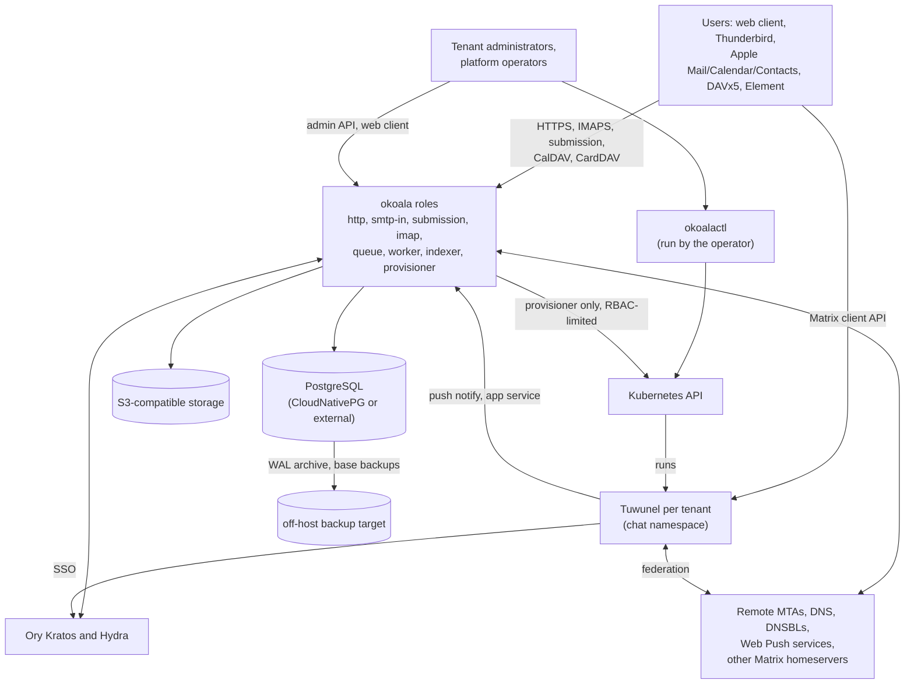
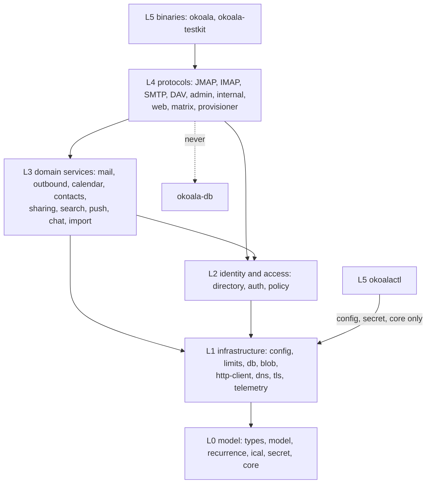

# Architecture

This document describes the shape of OKoala v1: what runs, how the code is layered, and
how tenants are kept apart. The reasons for each choice are in the
[decision records](../adr/README.md); the rules every change must keep are in
[invariants](invariants.md); the attackers and mitigations are in the
[threat model](threat-model.md); the tables are outlined in the [data model](data-model.md).

OKoala is in early development. This is the design the code is being built to, not a
description of finished code.

## Scope

OKoala is a multi-tenant server for mail, calendars, contacts and chat, with a web client.

- **Mail**: SMTP in and out (DKIM, SPF, DMARC, ARC, MTA-STS, DSNs), JMAP Mail and
  Submission, IMAP4rev2 with the extensions in [0002](../adr/0002-protocol-set-and-release-gates.md).
- **Calendars and contacts**: JMAP Calendars and Contacts, CalDAV and CardDAV with
  implicit scheduling, iTIP and iMIP, sharing ([0006](../adr/0006-sharing-semantics.md)).
- **Chat**: Matrix, with one Tuwunel homeserver per tenant
  ([0004](../adr/0004-chat-per-tenant-homeserver.md)).
- **Search, push**: full-text search with tantivy, EventSource, Web Push and a Matrix
  push gateway.
- **Storage**: PostgreSQL ([0001](../adr/0001-postgresql-only.md)) and S3-compatible
  object storage.
- **Identity**: Ory Kratos and Hydra ([0003](../adr/0003-identity-ory-identity-first.md)).
- **Deployment**: the Helm chart only, on Kubernetes or a one-machine k3s cluster set up
  by `okoalactl` ([0008](../adr/0008-deployment-helm-and-okoalactl.md)).

Not in v1: document editing and file sharing, desktop and mobile apps, APNs and FCM,
deployments other than the Helm chart, production hosts other than Linux, an embedded
database, and compatibility with other suites' APIs (Exchange ActiveSync, EWS).

## System context

## Roles

There is one server binary, `okoala`. Configuration selects which roles a process runs.
Each role is an `async fn run(ctx, shutdown)` in a `JoinSet`, sharing one process
`Context`. A role that fails ends the process, and Kubernetes restarts it. Roles are
registered in a role table, one line per role, pointing at the role's descriptor (name,
configuration section, listeners, led tasks, readiness checks).

| Role | Responsibility | Replicas (split profile) |
| --- | --- | --- |
| `http` | JMAP, EventSource, uploads and downloads, CalDAV and CardDAV under `/dav`, the web client, login and consent pages (with the chat consent tenant check), autoconfig, MTA-STS, the admin API under `/admin/v1`, the Matrix push gateway | 2+ |
| `smtp-in` | MX on port 25 | 2+ |
| `submission` | ports 587 and 465 | 2+ |
| `imap` | port 993 (143 with STARTTLS if enabled) | 2+ |
| `queue` | outbound delivery | 2+ |
| `worker` | job handlers (iTIP, alarms, push delivery, occurrence horizon, identity, imports, chat jobs) and led maintenance tasks | 2 |
| `indexer` | tantivy indexes and `/internal/v1/search` | 1 StatefulSet, optional warm standby |
| `provisioner` | per-tenant Kubernetes resources and Hydra clients: Tuwunel instances, their NetworkPolicies, Certificates and Ingresses, tenant-domain Certificates; chat upgrades and backups. The only role with a Kubernetes token | 1 active (Lease) and 1 standby |
| `migrate` | schema migrations, as a Helm hook Job before serving pods start | Job |

Every process behaves as one of several replicas, the `single` profile included; there is
no single-process code path. Every led task and job handler runs under panic isolation and
is restarted with backoff. A panic is counted and alerted, never a silent stop.

The chart has two profiles. `split` runs one Deployment per role. `single` runs the
serving roles together in one pod for small machines; the provisioner and the indexer are
separate pods in both.

## Process context

`Context` holds the typed configuration sections, `Db`, `BlobStore`, `ChangeHub`, the
`Directory` cache, `Policy`, `Limits`, `CpuPool`, the `Jobs` client, `SearchClient`,
`HttpClient` (one hyper and rustls client for every outbound HTTP call), `Resolver` (DNS)
and `Metrics`. Each field is an interface owned by one crate. Adding a field needs a
decision record, so `Context` does not grow into a bag of loosely related services.

## Layers and crates

Crates are arranged in six layers. Dependencies point only downward. `xtask check-layers`
will run in CI and fail on any upward or sideways edge the table does not allow.

| Layer | Crates | Rule |
| --- | --- | --- |
| L0 model | `okoala-types` (JMAP wire types), `okoala-model` (JSCalendar-bis, JSContact), `okoala-recurrence`, `okoala-ical` (calcard adapter), `okoala-secret`, `okoala-core` (ids, tenancy types, object types, error kinds, checked time) | no I/O, no async; compile to native and `wasm32` |
| L1 infrastructure | `okoala-config`, `okoala-limits`, `okoala-db` (pool, transactions, migrations, change log, notifier, leadership, jobs), `okoala-blob`, `okoala-http-client`, `okoala-dns`, `okoala-tls`, `okoala-telemetry` | no protocol or domain knowledge |
| L2 identity and access | `okoala-directory` (tenants, domains, accounts, addresses, groups, credentials, admin roles), `okoala-auth` (authenticators, `Principal`), `okoala-policy` (authorisation, `Authorized<T>`) | only `okoala-policy` constructs `Authorized<T>` |
| L3 domain services | `okoala-mail`, `okoala-outbound`, `okoala-calendar`, `okoala-contacts`, `okoala-sharing`, `okoala-search`, `okoala-push`, `okoala-chat`, `okoala-import` | own their SQL; every account-data function takes an `Authorized<…>` or runs as a system job |
| L4 protocols and adapters | `okoala-jmap` and one method crate per area, `okoala-imap`, `okoala-smtp`, `okoala-dav`, `okoala-admin-api`, `okoala-internal-api`, `okoala-web`, `okoala-matrix` (push gateway, application service, admin-bot client), `okoala-provisioner` (Kubernetes reconciler, Hydra admin client) | depend on L0 to L3, but never on `okoala-db`; only `okoala-provisioner` may depend on `kube-rs` |
| L5 binaries | `okoala` (CLI, role table, `serve`, `migrate`, admin CLI), `okoala-testkit`, `okoalactl` | `okoalactl` depends only on `okoala-config`, `okoala-secret` and `okoala-core`; `okoala` never depends on `okoalactl` |

Consequences of the layering:

- A protocol crate cannot open a transaction or read account data. It calls a domain
  service with an `Authorized<T>` that only `okoala-policy` can mint (invariant I6).
- Domain crates own their SQL modules. There is no shared store crate that every change
  edits. L3 SQL modules may not import the blob, HTTP or CPU-pool crates, which keeps
  I/O and heavy work out of transactions (invariant I5).
- JMAP methods are registered per area through a method registry, so there is no single
  JMAP crate that depends on every domain.
- The trust levels T0 to T2 ([0022](../adr/0022-trust-levels.md)) cut across these layers:
  T0 sits in L0 (`okoala-secret`), L1 (the transaction entry points of `okoala-db`) and L2
  (`okoala-policy`).

The repository layout is in [0005](../adr/0005-one-monorepo.md).

## A request through the layers

1. A listener in L4 accepts the connection and parses the request with bounded input.
2. `okoala-auth` authenticates it and produces a `Principal` (tenant, account, groups,
   kind, credential with its scopes).
3. A `Budget` (deadline, response bytes, rows read, CPU time, derived objects) is created
   for the request or command ([0007](../adr/0007-limits-as-requirements.md)).
4. The protocol crate loads an `AccessView` for the target account inside the request's
   read snapshot and calls `Policy::authorize`, which returns `Authorized<T>` or `Denied`.
   An object the principal may not read is "not found" in every protocol.
5. The domain service reads through a `ReadTx` or writes through `Db::write_account`,
   which takes the account row lock first, re-checks rights inside the transaction and
   records every change in the change log ([0014](../adr/0014-concurrency-and-state-model.md)).
6. After commit, the notifier sends a batched `pg_notify`; every process's `ChangeHub`
   wakes EventSource streams, IMAP IDLE sessions, the push enqueuer and the indexer.
7. CPU-heavy work (recurrence expansion, iCalendar and vCard parsing, MIME parsing of large
   parts, search queries) runs before or after the transaction in the bounded `CpuPool`,
   charged to the budget.

## State and change notification

- One sequence per account and a state per object type; IMAP MODSEQ is the same sequence.
- `membership_log` records container membership changes, so JMAP, DAV sync-collection and
  IMAP VANISHED are exact.
- Each process runs one listener connection for `okoala_changes`, `okoala_directory` and
  `okoala_cache`, with keepalives, a 15-second heartbeat and a 30-second fallback poll. On
  reconnect every subscriber re-reads the change log. A lost notification costs latency,
  never correctness.
- Shared accounts: a subscriber's events are filtered through its own `AccessView`.
- Retention is 90 days or one million rows per account
  ([0015](../adr/0015-change-log-retention.md)).

## Background work

One job framework in PostgreSQL serves all asynchronous work, with leases, idempotent
enqueue, timeouts, panic isolation, quarantine and per-tenant round-robin claims
([0019](../adr/0019-background-work.md)). Singleton tasks run under advisory-lock
leadership. The outbound mail queue has its own tables but the same claim library.

## Blobs

Blobs are content-addressed by SHA-256 and stored in S3 (a filesystem backend exists for
development and tests). Raw messages are stored exactly as received.

- **Write**: register the blob row as `live` → upload the bytes → insert the reference,
  guarded by `state = 'live'`.
- **Garbage collection** (led): claim an unreferenced blob by setting `deleting` after
  re-checking references → delete the bytes outside any transaction → forget the row. The
  grace period is never shorter than the point-in-time recovery window (30 days by
  default), so a restored database never references a collected blob.
- **Read**: whole-blob reads and spooled copies verify the hash; MIME parts use ranged
  reads; everything streams.
- Process-local caches of blob bytes are invalidated before the bytes are deleted.
- The S3 client is OKoala's own HTTP client with a sans-IO request signer, no environment
  proxy, and a configurable CA.

## Mail path

Inbound SMTP streams DATA to a spool, then to the blob store; the MIME index is computed in
the CPU pool; one delivery transaction covers all local recipients, locked in
`(tenant, account)` order. SMTP answers `250` only after commit and 4xx when unsure
(invariant I11). SPF, DKIM, DMARC and ARC are checked with `mail-auth`. Submission checks
that the `From` and envelope addresses belong to the authenticated account; DKIM signing
is per tenant domain. iMIP parts are recorded as `itip.apply` jobs in the delivery
transaction, and an inbound REPLY is applied only when the sender's domain is
DMARC-aligned with the attendee. Submitted mail's `Received:` header leaves out the
client's IP address by default.

## Tenancy

Tenant isolation covers both data and capacity.

**Data.**

- Every tenant table has `tenant_id` first in its primary key and indexes, and a row-level
  security policy on `app.tenant_id`, set per transaction with `SET LOCAL` (invariant I1).
  This includes the directory, credentials, queue and jobs tables.
- Database roles by duty, each with its own credential:

  | Role | Used by | Can |
  | --- | --- | --- |
  | `okoala_owner` | the `migrate` Job only | own and change the schema |
  | `okoala_app` | serving processes | read and write tenant rows under RLS |
  | `okoala_platform` | `write_platform` and job claiming | read across tenants for platform work |
  | `okoala_drill` | the restore drill | own only the scratch database |
  | backup identity | CloudNativePG | write backups that serving pods cannot read |

  The server refuses to start if its credential is the owner's, since RLS would not apply.
- Account ids are unique across the installation, so wire ids never collide in a session
  with shared accounts. The database still keys by `(tenant_id, account_id)`.
- Domains, DKIM keys, MTA-STS policies and certificates are per tenant domain.
- Cross-tenant sharing needs an explicit grant that both tenants' policies allow.

**Capacity.** Per-tenant limits and overrides, per-tenant fair claims for every queue
(invariant I13), and per-tenant search indexes. No tenant can delay another tenant's mail,
alarms, invitations or indexing beyond the configured fairness bounds.

**Chat.** Each chat-enabled tenant has its own Tuwunel instance on its primary chat domain,
with its own volume, Secret, signing key, Hydra client and admin bot, in a separate
namespace with its own NetworkPolicy. Tuwunel cannot reach PostgreSQL, the internal API or
another tenant's pod, and reaches Hydra, the push gateway and other homeservers only
through their public URLs. Rooms and messages are authorised by the tenant's homeserver;
OKoala authorises what it owns around chat: enabling chat, localparts, the federation
allow-list, the SSO consent (invariant I15), push devices and the application service.

**Tenant states.** `active`; `suspended` (all access refused, inbound mail answered 4xx for
seven days, then 5xx); `deleting` (a job removes data in batches, and blobs follow through
garbage collection).

## Identity and authentication

- Kratos holds identities, credentials, recovery and sessions; Hydra issues tokens; OKoala
  holds tenants, accounts, groups, roles, quotas, app passwords and suspension.
- Accounts are provisioned by an idempotent job that creates the Kratos identity with
  `metadata_admin = {tenant_id, account_id}`. Nothing is created or linked by email.
- Authenticators: OIDC bearer tokens (JMAP; EventSource with the header or a short-lived
  signed ticket, never a token in the query string), app passwords limited to protocol
  scopes (IMAP, SMTP, DAV Basic over TLS), and development tokens only in `dev-auth`
  builds. Failures are rate limited per IP and per account.
- Platform operator and tenant administrator are roles on the identity; the admin API
  uses the same tokens and authorises through `Policy`.
- Credentials are re-checked during long sessions: IMAP every five minutes and on
  directory invalidation; EventSource ends at token expiry.

## Configuration, secrets and the internal API

- Configuration is TOML. Each crate declares its section with
  `serde(deny_unknown_fields)` and registers it; the loader rejects unknown sections and
  reports all errors at once. Values come from the file or `OKOALA_<SECTION>__<KEY>`
  variables; secret values only from files or variables, never inline in a ConfigMap.
- `okoala-secret` provides `Secret<T>`, which reduces accidental exposure: a redacting
  `Debug`, no `Display` and no `Serialize`. Reading the value takes an explicit call,
  `reveal_value()`. Comparisons (`compare`, `compare_value`, `compare_bytes`) are
  constant-time for inputs of equal length; a length difference returns at once, so the
  length is not hidden. An empty stored secret never matches. Only the wrapped value is
  zeroized on drop; copies made before wrapping or from the revealed value are not. It is
  a pure type with no I/O. Loading secrets and the file-mode rule live in
  `okoala-config`; the database URL type, whose password is a `Secret`, lives in
  `okoala-db`.
- The `okoala` binary will disable core dumps for itself at start, because secrets that
  live for the whole process are not covered by zeroize-on-drop.
- The internal listener ([0020](../adr/0020-internal-api.md)) serves probes and metrics,
  and `/internal/v1/*` behind a bearer secret and a NetworkPolicy.

## Web client

The web client (Vite, React, TypeScript) carries mail, calendars, contacts, chat and
settings. Its logic is TypeScript ([0021](../adr/0021-client-logic-in-typescript.md)), with
wire types generated from Rust. Chat uses matrix-js-sdk with its Rust crypto in WASM,
loaded lazily; SSO runs in a popup with a checked `state`; the chat and crypto stores are
wiped on sign-out in every tab. The Content-Security-Policy's `connect-src` names the
signed-in tenant's homeserver only. The client is tested against the real server
([0009](../adr/0009-web-client-tested-against-real-server.md)).

## Deployment

- Deployments for the serving roles (two replicas each, PodDisruptionBudgets, topology
  spread), a StatefulSet for the indexer, the `migrate` hook Job with its own
  ServiceAccount, and the provisioner with its own ServiceAccount.
- PostgreSQL through CloudNativePG (a primary and two replicas, WAL archive to S3) or
  external; S3 external or in-cluster; Ory through its upstream charts.
- Mail ports through LoadBalancer Services with PROXY v2 or `externalTrafficPolicy: Local`;
  HTTP through the Ingress; certificates from cert-manager.
- Hardened pods: non-root, read-only root filesystem, all capabilities dropped,
  `RuntimeDefault` seccomp; a distroless image.
- No secret is generated at chart render time. CI will check the chart with `helm lint`,
  `helm template`, `kubeconform -strict` and `okoala serve --check`, and install it on a
  kind cluster nightly.
- Backups: CloudNativePG WAL archiving and daily base backups to an off-host S3 target
  with 30 days of point-in-time recovery; blobs by bucket versioning or a daily copy; chat
  volumes by encrypted per-tenant backups. Restore drills run weekly for the database and
  blobs, and on the operator's schedule for chat.
- Migrations are expand and contract, so a rolling upgrade can run two versions at once.
  `okoalactl upgrade` takes a backup first and rolls back the chart on a failed check.

## Observability

`tracing` with one span per connection or request (tenant, account and session ids; never
content or credentials) and JSON logs. Prometheus metrics cover request latencies,
transaction durations by call site, notifier lag, leadership, job queue depth and age per
kind and tenant, delivery and authentication results, limiter rejections, budget
exhaustion, and per-tenant chat health and backup age. Alerts ship with the chart. v1
targets: JMAP p99 under 500 ms, delivery accepted-to-visible p99 under 5 s, alarm delay p99
under 60 s.
