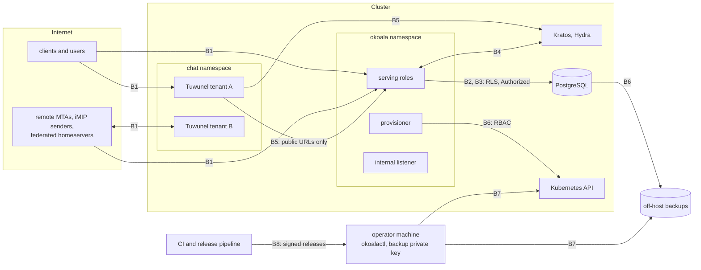

# Threat model

This document lists what OKoala protects, from whom, where the trust boundaries are, and
how each main threat is mitigated. Mitigations point at the [invariants](invariants.md)
(I1 to I17) and the [decision records](../adr/README.md). It describes the v1 design;
OKoala is in early development and the document is updated as each part is built and
reviewed.

To report a vulnerability, see [SECURITY.md](../../SECURITY.md).

## Assets

| Asset | Why it matters |
| --- | --- |
| Tenant data: mail, calendars, contacts, chat history | confidentiality and integrity per tenant and per user |
| Credentials: passwords and MFA (in Kratos), app passwords, OIDC tokens, sessions | account takeover |
| Installation secrets: DKIM keys, TLS keys, database and S3 credentials, Ory secrets, internal API secret, VAPID key | impersonation of tenants' domains, access to all data |
| Per-tenant chat secrets: the Matrix signing key, access tokens, the Hydra client secret, application-service tokens | impersonation of the tenant on the Matrix federation; it cannot be rotated in v1 |
| Backups: database, blobs, chat volumes | contain all of the above |
| Availability and fair capacity per tenant | mail and alarms must not be delayed by another tenant |
| The tenant binding of identities | decides which tenant's data a token reaches |
| The release artefacts and their provenance | what operators run |

## Actors

Ordered by how much the design assumes of them. The first two are the primary attackers:
they are inside the system by design.

1. **Hostile tenant, or a tenant administrator acting against others.** Controls its own
   accounts, domains, data and configuration within its tenant. Wants other tenants' data,
   or to degrade their service.
2. **Authenticated user.** Holds valid credentials for one account. Wants data of other
   accounts, more rights than granted, or to exhaust resources with crafted but valid
   requests (recurrence rules, MIME structures, IMAP sorts, sync storms).
3. **Compromised third-party client.** A mail or calendar app holding an app password or
   token.
4. **External senders.** Remote MTAs and iMIP senders, including spoofed senders: crafted
   messages, invitations and replies.
5. **Anonymous Internet hosts.** Can reach every public listener: SMTP, submission, IMAP,
   HTTPS, DAV, the push gateway, homeservers.
6. **Network attackers** between clients or servers and OKoala: interception, downgrade,
   spoofed DNS answers.
7. **Federated Matrix homeservers.** Spam, oversized events, abuse of state resolution.
8. **A compromised tenant homeserver.** Code execution in one tenant's Tuwunel pod.
9. **A compromised OKoala pod.** Remote code execution in a serving role, or a stolen
   provisioner token.
10. **A compromised developer, operator or CI machine, or a compromised dependency.**
    Steals credentials stored on the machine, or tampers with code, builds or downloads.

## Trust boundaries

| Boundary | Between |
| --- | --- |
| B1 | the Internet and every public listener (OKoala's and each homeserver's) |
| B2 | an authenticated principal and the data its account may reach |
| B3 | one tenant and another, for data and for capacity |
| B4 | the identity provider (Kratos, Hydra) and OKoala |
| B5 | each tenant's homeserver and OKoala, other tenants and the federation |
| B6 | a serving process and the database owner role, backups and the Kubernetes API |
| B7 | the operator's machine and the cluster |
| B8 | the development and release process and what operators run |

## Threats and mitigations

### B1. Public listeners

| Threat | Mitigation |
| --- | --- |
| Parser exploits in IMAP, SMTP, MIME, iCalendar, vCard, DAV XML, JMAP JSON | Rust with no `unsafe` (I17); `indexing_slicing` and `as_conversions` denied in parser crates; `cargo-fuzz` targets for every parser, short runs per change and long runs nightly; Tier 1 review of every line |
| Resource exhaustion by unauthenticated hosts (slowloris, huge literals, SMTP smuggling) | line, literal and message size limits; SMTP smuggling and slowloris defences; per-IP throttles and authentication-failure limiters shared across replicas ([0007](../adr/0007-limits-as-requirements.md)) |
| Credential guessing | failures limited per IP and per account in PostgreSQL; MFA in Kratos; app passwords are random, scoped and revocable |
| Interception or downgrade | TLS on every listener (cert-manager); MTA-STS for outbound mail; DAV Basic only over TLS; STARTTLS on IMAP 143 only if enabled |
| Spoofed client addresses through a load balancer | PROXY v2 accepted only from configured networks |
| Abuse of the unauthenticated Matrix push gateway | acts only on a device whose server-generated 43-character `pushKey` and `app_id` both match; body and device-count caps; per-device coalescing and rate limits; notifications carry only event and room ids |
| Probing for accounts | unknown and forbidden objects and principals give identical answers in every protocol |

### B2. Principal to data (authorisation)

| Threat | Mitigation |
| --- | --- |
| A protocol path that forgets an authorisation check | protocol crates cannot reach account data without `Authorized<T>`, which only `okoala-policy` mints (I6); `okoala-policy` is T0 ([0022](../adr/0022-trust-levels.md)) |
| Rights escalation through sharing | a `mayShare` grantee grants at most its own rights and cannot change its own entry; owner-only actions decided by ownership ([0006](../adr/0006-sharing-semantics.md)) |
| Patch-level bypass (a sharee with `mayRSVP` changing the event) | patch rules implemented once on flat patch maps with JSCalendar override semantics, for every protocol |
| Revocation races | rights re-checked inside the write transaction |
| App password used beyond its protocol | protocol scopes checked by each authenticator |
| Stale sessions after disabling | sessions and tokens revoked; IMAP rechecks every five minutes and on directory invalidation; EventSource ends at token expiry |
| Lost updates or missed changes | locked write transactions and states from one snapshot (I2, I3, I4) |
| Coverage gaps | the policy matrix test covers every principal kind against every object type and action through every protocol; CI fails on a missing entry |

### B3. Tenant to tenant

| Threat | Mitigation |
| --- | --- |
| Cross-tenant reads through a faulty query | `tenant_id` leading every key and RLS on every tenant table (I1); serving processes connect as `okoala_app`, never as the owner |
| Cross-tenant sharing without consent | explicit grant, both tenants' policies must allow it, default deny |
| Shared-account notifications leaking objects | change events filtered per subscriber through its own access view |
| One tenant starving others (imports, invitation storms, alarm floods) | per-tenant fair claims for every queue (I13); per-tenant limits; per-tenant search indexes |
| Expensive stored data (recurrence bombs, deep MIME) | write-time validation (I7); materialised occurrences with a cap; heavy work in the bounded CPU pool (I8) |
| A tenant sending as another tenant's domain | From and envelope ownership checks on submission; DKIM keys per tenant domain |
| Spoofed iMIP replies changing another organiser's event | a REPLY is applied only when the sender's domain is DMARC-aligned with the attendee; others are kept as unprocessed notifications |

### B4. Identity provider and OKoala

| Threat | Mitigation |
| --- | --- |
| Self-registration into a tenant | no self-registration in v1; accounts created by administrators ([0003](../adr/0003-identity-ory-identity-first.md)) |
| A user editing its own tenant binding | the binding is in Kratos `metadata_admin`, not in user-editable traits |
| Account linking by email address | never done, by any code path; rebinding is an operator action |
| Tokens accepted for the wrong audience, tenant or a disabled account | verifier requires `aud = okoala`, the `okoala` scope, a `tenant` claim and a known, enabled account |
| Consent page CSRF or skipped checks | CSRF-protected consent page; checks run on every consent, shown or skipped |
| Development tokens in production | `dev-auth` is a cargo feature; CI checks the release binary does not contain it |
| Webhook forgery | Kratos webhooks need their own secret on the internal listener |
| Drift between Kratos and OKoala | hourly reconciliation that reports drift, never links or creates, and disables at most a configured number per run |

### B5. Chat homeservers

| Threat | Mitigation |
| --- | --- |
| A user of tenant B signing in through tenant A's homeserver | the consent handler refuses any identity whose tenant differs from the Hydra client's `metadata.tenant` (I15); one Hydra client per tenant; a cross-tenant SSO test in the chat end-to-end gate |
| Localpart collisions within a tenant | `preferred_username` set from the directory's unique chat localpart, never from an email local part |
| Pods bypassing the Ingress to reach a homeserver | a NetworkPolicy per tenant: ingress only from the Ingress controller |
| A compromised homeserver reaching OKoala's database, internal API or other tenants | egress only to DNS, the Ingress controller and public addresses; no route to PostgreSQL, the internal listener or other tenants' pods |
| SSRF through URL previews or federation | Tuwunel's default IP denylist for private ranges stays on; internal services reached only by public URL |
| Malicious federated homeservers | per-tenant federation allow-list and off switch; Tuwunel's own limits; per-tenant resource limits |
| Forged application-service calls | accepted only from the tenant's own homeserver with its per-tenant token |
| Theft of chat backups | backups encrypted to an operator public key; the private key never enters the cluster, so a stolen S3 credential or a compromised cluster cannot read them ([0004](../adr/0004-chat-per-tenant-homeserver.md)) |
| Loss of a tenant's volume | scheduled backups, retained volumes, purge only by explicit confirmation (I16) |
| Chat data left in a browser after sign-out | chat and crypto stores wiped on sign-out in every tab |

### B6. Containment after a pod compromise

| Threat | Mitigation |
| --- | --- |
| Changing the schema or bypassing RLS from a serving pod | serving pods get only `okoala_app` and `okoala_platform` credentials; the owner credential is used only by the `migrate` Job; the server refuses to start with the owner credential |
| Reading or deleting backups | backups run with their own identity and storage that serving pods cannot mount |
| Using the Kubernetes API | serving pods have no token; only the provisioner has one, limited by a namespaced Role to the kinds it owns, Leases and pods `get/list/delete`; no `pods/exec`, no `pods/ephemeralcontainers` (I14) |
| A stolen provisioner token | it cannot read volumes or exec into pods; it can only manage its labelled objects, and never deletes a volume without a purge (I16) |
| Secrets in logs, core dumps or error messages | `Secret<T>` (I10); log-scrubbing test; core dumps disabled at start |
| Calling internal routes from another pod | bearer secret on `/internal/v1/*` and a NetworkPolicy to the namespace ([0020](../adr/0020-internal-api.md)) |
| Escape from the container | non-root, read-only root filesystem, no capabilities, `RuntimeDefault` seccomp, distroless image; no Docker socket, Helm or k3s in the server ([0008](../adr/0008-deployment-helm-and-okoalactl.md)) |

### B7. Operator machine and the cluster

| Threat | Mitigation |
| --- | --- |
| Tampered k3s, Helm or chart downloads | `okoalactl` verifies pinned versions against checksums compiled into it; `okoalactl` itself is a signed release |
| Exposed control plane | `okoalactl preflight` checks that the Kubernetes API and kubelet ports are not reachable from the Internet, on IPv4 and IPv6 |
| Weak host setup | `preflight` refuses to install on failed hard checks: SSH password login, root login, key file modes, sudo logging, time sync, listeners on IPv4 and IPv6 |
| Secrets left on the operator's machine | `okoalactl` generates secrets directly as Kubernetes Secrets, writes files with `umask 077` and keeps no copy |
| Loss of the backup private key | documented: backups made with a lost key cannot be restored; the operator keeps old keys until their backups expire |
| Destroying data by an install against existing data | install and upgrade refuse to start an empty database next to existing data |

### B8. Development and release process

| Threat | Mitigation |
| --- | --- |
| Credentials stolen from a developer or operator machine | one SSH key per machine and purpose, never copied, hardware-backed where possible; no long-lived secrets in shell configuration files; short-lived, narrowly scoped tokens; CI and deploy credentials never on developer machines; inventories of hosts, keys and tokens reviewed regularly |
| A compromised build machine | release images are built only by CI on ephemeral, project-only runners ([0012](../adr/0012-infrastructure.md)) |
| Over-privileged CI | least-privilege `GITHUB_TOKEN` permissions; OIDC federation instead of stored secrets where possible; environment-scoped staging secrets that cannot reach production |
| Malicious or vulnerable dependencies | `cargo deny` (licences, sources, bans) and `cargo audit` in CI; a new advisory fails CI; pinned toolchain; third-party test images pinned by digest and mirrored |
| Tampered releases | releases built from the public repository, signed with Sigstore (keyless cosign) with build provenance; reproducible builds checked by building twice; SBOM with each release |
| Unreviewed code in the isolation core | T0 written by hand and reviewed adversarially; `xtask check-trust` (I17); every published commit reviewed ([checklist](../reviews/CHECKLIST.md)) |

## Residual risks

These are accepted for v1, or reduced but not removed.

- **The Matrix signing key cannot be rotated.** Tuwunel offers no import, export or
  rotation. A suspected exposure has no supported remedy in v1; backups holding the key are
  encrypted to a key outside the cluster.
- **One homeserver replica per tenant.** No high availability for chat; upgrades
  interrupt a tenant's client API for a few seconds. Restoring an older chat backup can
  bring back used end-to-end encryption one-time keys, so some sessions may fail to
  decrypt.
- **Losing a chat volume without a recent backup** loses the tenant's Matrix identity,
  local rooms and device keys.
- **Chat restore drills are operator-run**, since only the operator holds the private
  key; an alert fires when one is overdue, but a neglected schedule is possible.
- **Federation is on by default** for new tenants, so remote spam and abuse reach tenants
  until they set an allow-list or turn it off.
- **Metrics and probes are unauthenticated** inside the namespace; they must never carry
  tenant content or credentials.
- **Internal traffic is not mutually authenticated** by TLS in v1; the bearer secret and
  NetworkPolicies are the controls.
- **A compromised Kubernetes control plane or node** defeats the in-cluster controls.
  Chat backups stay unreadable; database and blob backups do not.
- **The hand-written T0 claim** is checked mechanically against commit trailers, but rests
  on the engineers' honesty.
- **Parsers of untrusted input** are protected by fuzzing and review, not by proof.
- **Deliverability and reputation** of new domains depend on factors outside OKoala.
- **No external audit** has been made; assurance comes from public CI, conformance and
  interop results, fuzzing, dependency audits, adversarial reviews and public reports.

## Keeping this document current

The threat model is reviewed whenever a decision record changes a boundary, and at each
milestone, against what was built. New attack surface (a protocol, a role, a permission)
adds rows here in the same change.
